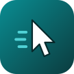

<p align="center">
  
</p>

# Nudge

[](https://github.com/Scag95/Nudge/actions/workflows/windows.yml)

Copiás algo en el celu y lo pegás en la PC. O al revés. Y cuando estás en el
sillón, el mismo celu hace de mouse y teclado de la PC.

Nudge hace eso entre un teléfono Android y una PC con Linux o Windows que
estén en la misma WiFi. El celu encuentra la PC solo (mDNS) y todo pasa por la
red local: no hay cuentas, ni nube, ni cables.

Antes se llamaba Clipboard Share. Si venías usando esa versión, mirá
[Migración desde clipboard-share](docs/linux.md#migración-desde-clipboard-share).

## Qué hace

- **Clipboard en los dos sentidos**, con texto e imágenes. PC → celu funciona
  en segundo plano; celu → PC con la app cerrada también, después de darle
  dos permisos por `adb` (ver [android.md](docs/android.md#sync-de-clipboard-en-segundo-plano-celu--pc)).
- **Mouse y teclado remotos** desde el celu: trackpad, teclado, botones de
  click y atajos.
- **Emparejamiento que aprobás vos**: ningún teléfono maneja tu PC hasta que lo
  aceptás en la PC.
- **Solo red local**: el servidor corre en tu PC y el celu le habla
  directamente.

## Plataformas

| Plataforma | Qué hay | Estado |
|------------|---------|--------|
| Linux (Arch/Omarchy) | Paquete `nudge`: servidor, CLI y panel con ícono en la bandeja | Probado instalando el paquete; es la versión más completa |
| Windows 10/11 x64 | Zip con instalador por usuario e ícono en la bandeja | Beta: probado en GitHub Actions (`windows-latest`), todavía no en una PC física |
| Android | APK con firma debug | Beta personal, sin Play Store |

Los tres están en la [release 0.1.0](https://github.com/Scag95/Nudge/releases/tag/v0.1.0)
(pre-release), con un `SHA256SUMS` para verificar las descargas.

## Instalar

**Linux (Arch/Omarchy)**

```bash
sudo pacman -U nudge-0.1.0-1-x86_64.pkg.tar.zst
nudge-panel
```

Para el control remoto tu usuario tiene que poder escribir en `/dev/uinput`.
Eso, el panel, el inicio automático y cómo compilar el paquete están en
[docs/linux.md](docs/linux.md).

**Windows**

Extraé el zip y hacé doble clic en `Install Nudge.cmd`. No pide
administrador, salvo para las reglas del firewall (te pregunta). Los
ejecutables no están firmados, así que SmartScreen puede avisar. Detalles en
[docs/windows.md](docs/windows.md).

**Android**

Instalá el APK a mano (o con `adb install`). Para que el celu mande su
clipboard con la app cerrada hacen falta dos comandos de `adb`, explicados en
[docs/android.md](docs/android.md).

## Cómo se empareja

1. En el celu abrís Nudge y elegís tu PC de la lista.
2. En la PC aparece la solicitud con el nombre del teléfono: en Linux, un
   aviso en la bandeja que abre el panel; en Windows, una notificación en la
   bandeja y una ventana Sí/No (con No por defecto).
3. Compará el código de verificación: el celu muestra uno como
   `4F2A-91C7-0B3E` y la PC el mismo (en el panel, en la ventana Sí/No o con
   `nudge pair list`). Si no coinciden, rechazá: otro equipo se está haciendo
   pasar por tu PC.
4. La aprobás. La solicitud caduca a los 90 s si no hacés nada.
5. De ahí en más el celu se reconecta solo, incluso después de reiniciar la
   PC. Si perdés el teléfono, lo revocás desde el panel o con
   `nudge pair revoke`.

El código de la PC se puede ver en cualquier momento, haya o no solicitudes:
en el panel de Nudge (Linux), en el menú del ícono de la bandeja (Windows,
clic derecho: `Código: XXXX-XXXX-XXXX`) o con `nudge pair list`. Si la PC ya
conocía el teléfono (por ejemplo, al actualizar desde una versión sin
cifrado o después del aviso "El certificado de la PC cambió"), te da acceso
sin ventana de aprobación; entonces el celu pregunta "¿La PC muestra el
código …?" antes de guardarla: tocá **Sí, coincide** solo si es el mismo;
con **No** no se guarda nada y el emparejamiento se cancela.

Si borrás la configuración del servidor (o solo su clave, `tls.key`), la PC
genera otro certificado y cada teléfono tiene que emparejarse de nuevo.

## Privacidad y seguridad

- Nada sale de tu red local: no hay servidor externo ni cuenta.
- El mouse y el teclado solo responden a teléfonos que aprobaste; cada uno
  tiene su token.
- Cualquiera en la red puede *pedir* emparejarse, por eso aprobar es siempre
  un clic tuyo. El panel nunca aprueba solo.
- Todo el tráfico entre el celu y la PC va cifrado (HTTPS y WSS) con un
  certificado autofirmado de la PC. Al emparejar, el celu guarda su huella y
  después rechaza cualquier otro certificado; el código de verificación es
  lo que te protege en ese primer contacto.
- El portapapeles, igual que el mouse y el teclado, solo responde a
  teléfonos que aprobaste: sin su token, la PC no deja leerlo ni escribirlo.
- La app de Android no guarda en sus logs lo que copiás, solo el tipo y el
  tamaño.

## Estado del proyecto

Es un proyecto personal, en pre-release. Linux + Android es la combinación
probada. Windows y el sync celu → PC con la app cerrada todavía tienen
asteriscos: el primero no pasó por una PC física, y el segundo depende del
texto de un log del sistema de Android, que puede cambiar entre versiones; lo
probé en Android 16 (Samsung S24).

El detalle de qué está hecho y qué falta está en
[docs/development.md](docs/development.md#estado-del-proyecto).

## Documentación

- [Linux](docs/linux.md): paquete, panel, inicio automático, permisos de
  uinput, puerto, migración.
- [Windows](docs/windows.md): instalación, emparejamiento, firewall,
  desinstalación, log.
- [Android](docs/android.md): APK, sync en segundo plano y cómo funciona.
- [Desarrollo](docs/development.md): arquitectura, compilar, API HTTP,
  protocolo de control remoto, tests.

## Licencia

MIT. Ver [LICENSE](LICENSE).
